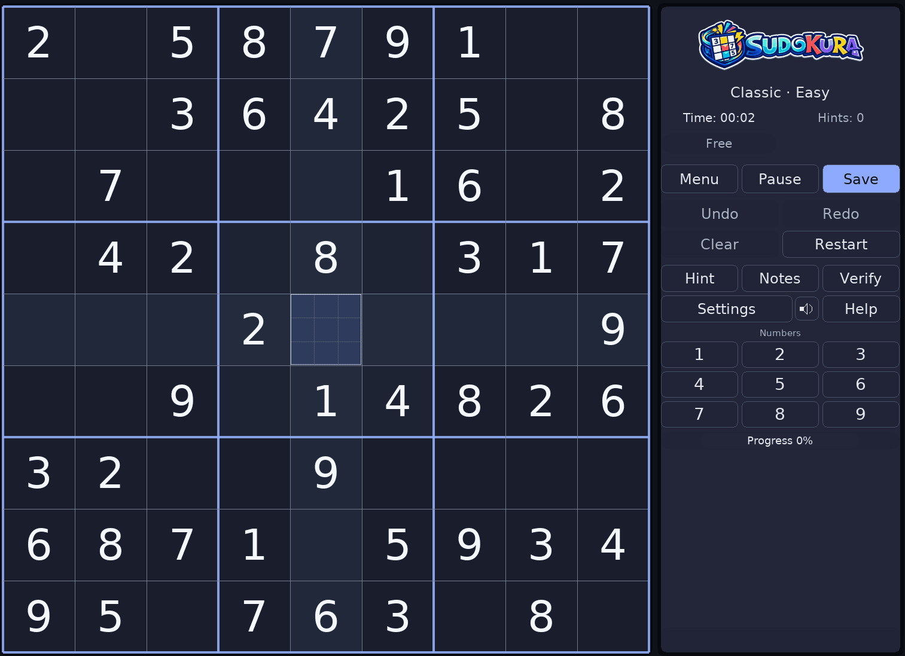

# Sudokura

  

  <strong>A little time for a good puzzle.</strong>

  Classic Sudoku, daily challenges, and just enough help when you need it. 
  No accounts, no ads, no analytics. Just you and the grid.

  <a href="#download">Download</a> ·
  <a href="#play-your-way">Features</a> ·
  <a href="docs/images/README.md">Screenshots</a> ·
  <a href="docs/RELEASE_NOTES_1.3.9.md">What's new</a>

---

## Download

  
  
  
  

  Windows 11 x64 · Linux x86_64 · macOS 15+ Apple Silicon (experimental) 
  Buttons open the latest <strong>published</strong> release. Choose the file for your platform.

Installation and download verification

- **Windows:** choose the installer or the single-file, installation-free portable EXE. Unsigned Windows builds may trigger a SmartScreen reputation warning.
- **Linux:** make the AppImage executable with <code>chmod +x Sudokura-*-Linux-x64.AppImage</code>. If FUSE is unavailable, launch with <code>--appimage-extract-and-run</code>.
- **macOS:** the Apple Silicon DMG is experimental, ad-hoc signed, and not Apple-notarized.
- **Integrity:** the [release page](https://github.com/santirodriguez/Sudokura/releases/latest) includes <code>SHA256SUMS.txt</code> and a matching Build-Info file.

## A familiar board, carefully made

  
   
  Regular desktop gameplay — the approved view remains unchanged in v1.3.9.

<table>
<tr>
<td width="33%" valign="top">
<strong>Thoughtful puzzles</strong>  
Easy, Medium, and Hard puzzles with unique solutions and difficulty based on human-solving techniques.
</td>
<td width="33%" valign="top">
<strong>Comfortable controls</strong>  
Play with a keyboard, mouse, or desktop touchscreen. Notes, Undo/Redo, hints, and themes are close at hand.
</td>
<td width="33%" valign="top">
<strong>Yours to keep</strong>  
Sudokura works offline. Your games, settings, and history stay in local storage, not on somebody else's server.
</td>
</tr>
</table>

## Play your way

- **Classic** — enjoy the puzzle at your own pace.
- **Strikes** — every mistake counts.
- **Time Attack** — solve against the clock.
- **Daily Puzzle** — a consistent challenge for each local calendar day.

Save and resume an attempt, collect finished games in **Saved Games**, or revisit a puzzle with Replay. Use Notes, Hint, Verify, Undo/Redo, and Restart whenever you need them.

Choose light or dark themes, reduced motion, and optional music and sound effects. Available in **English, Español, and Català**.

Keyboard shortcuts

| Action | Shortcut |
|---|---|
| Move / enter / clear | Arrow keys or WASD · 1–9 · Backspace/Delete |
| Notes | N · Shift+1–9 · right-click |
| Undo / Redo | Ctrl+Z / Ctrl+Shift+Z (or Ctrl+Y); Cmd equivalents on macOS |
| Save / Saved Games | Ctrl+S / Ctrl+O; Cmd equivalents on macOS |
| Hint / Verify / Pause | H · Ctrl+Enter · P |
| Theme / Language / Audio | T · L · V |
| Help / About | F1 / F2 |

All essential actions are also available through the interface.

## Private, even when you take a break

Sudokura has no account, cloud sync, or telemetry. **Save** keeps the latest state of the same attempt, while the Saved Games library lets you load, inspect, replay, or delete retained games.

Existing compatible v1.2 and v1.3 desktop data keeps its migration and recovery safeguards. If you're moving between versions, **keep your complete game-data folder**. See [saves, recovery, and rollback](docs/REPORTING_ISSUES.md).

## Android is on its way

An early ARM64 prototype has been tested on a real phone, but **there is no public Android release yet**. The eventual plan is a signed APK on GitHub that Obtainium can follow, an application for F-Droid inclusion, and possibly Google Play. Each channel requires its own readiness and update-safety checks.

Read the [Android release roadmap](docs/ANDROID_RELEASE_PLAN.md) for current status and requirements. Debug previews are not a stable upgrade path.

## Build & contribute

Sudokura is written in **C11**, using SDL2, SDL2_ttf, and SDL2_mixer.

Build from source

Install a C compiler, <code>pkg-config</code>, SDL2, SDL2_ttf, SDL2_mixer, Python 3, and Go.

~~~sh
make assets
make
make test
make test-ui
./sudokura
~~~

More build and engineering details are in [Development](docs/DEVELOPMENT.md).

Found a bug or have an idea? [Open an issue](https://github.com/santirodriguez/Sudokura/issues). For release history, screenshots, development notes, and troubleshooting, visit the [documentation index](docs/README.md).

## Support Sudokura

Sudokura is a free, open-source game made by [Santiago Rodriguez](https://santiagorodriguez.com). If you enjoy playing it, you can support its continued development.

  

Music: Cozy Puzzle Jingle & Result by MintoDog ([CC0](https://opengameart.org/content/cozy-puzzle-jingle-result)) · Language flags by [lipis/flag-icons](https://github.com/lipis/flag-icons) (MIT)

**[GPLv3](LICENSE)** · © 2025–2026 [Santiago Rodriguez](https://santiagorodriguez.com/)
