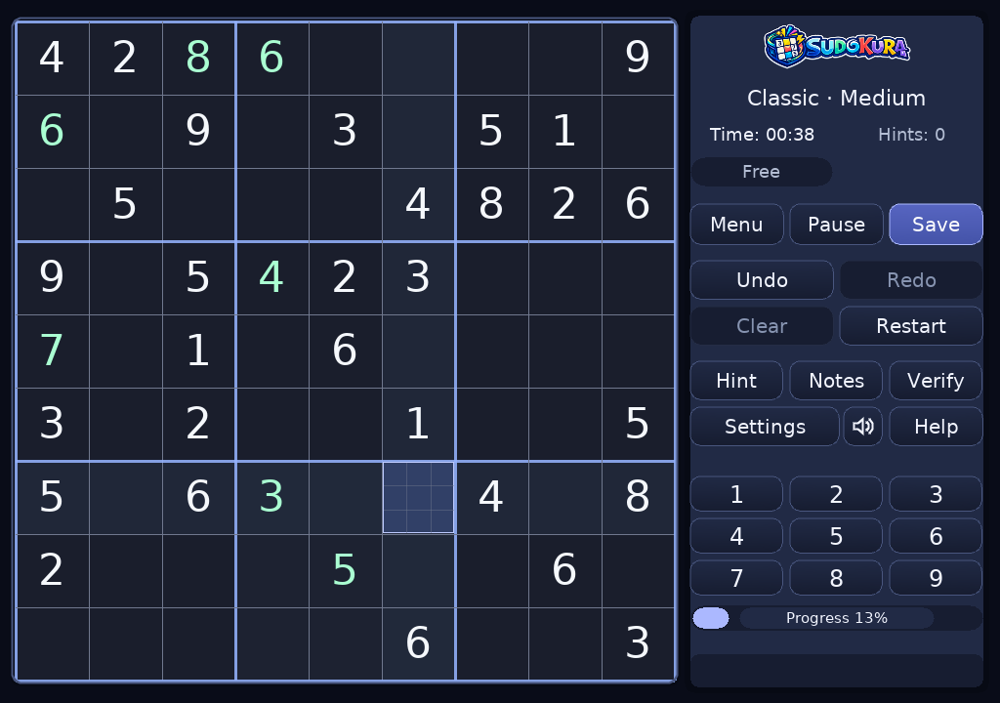
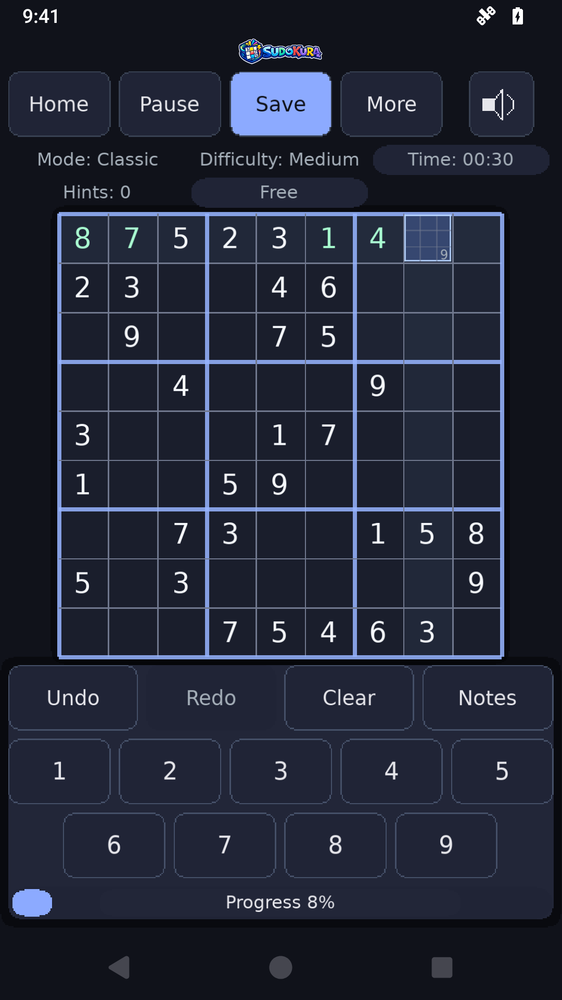
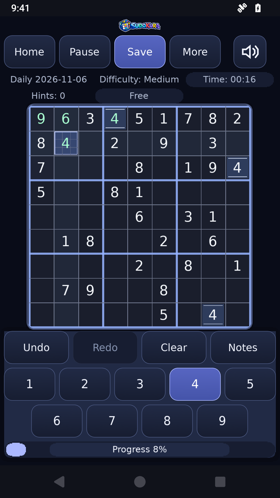
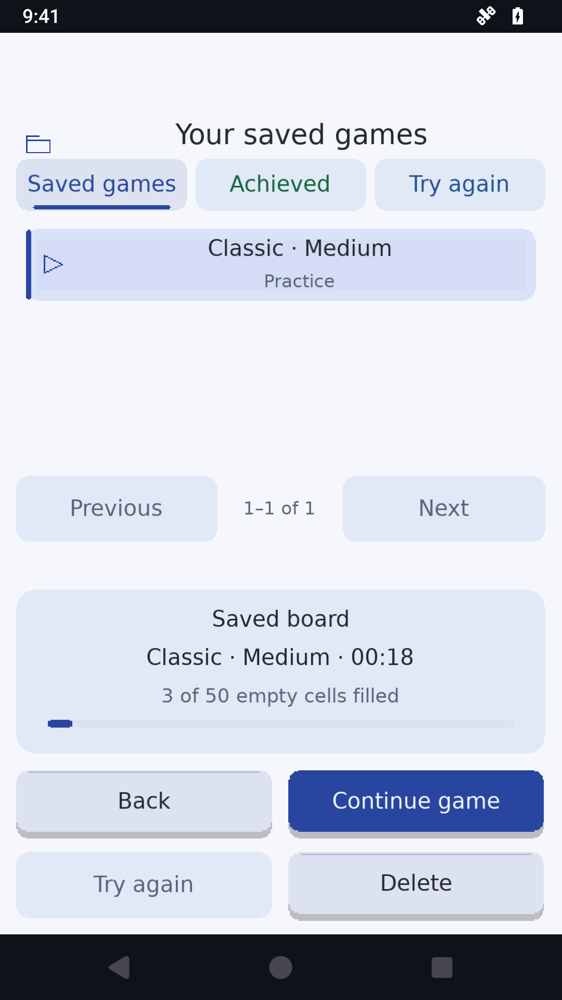

# Sudokura

<p align="center">
  
</p>
<p align="center"><strong>A little time for a good puzzle.</strong></p>
<p align="center">
  A clean grid. A satisfying challenge. Just enough help when you want it.<br>
  Start with an easy one, come back for the Daily, or give that stubborn 7 another chance.
</p>
<p align="center">
  <a href="#pick-your-puzzle">Play your way</a> ·
  <a href="#see-the-board">Screenshots</a> ·
  <a href="#download">Download</a> ·
  <a href="docs/RELEASE_NOTES_1.4.0.md">What's new in 1.4.0</a> ·
  <a href="docs/README.md">Docs</a>
</p>

---

## Pick your puzzle

<table>
<tr>
<td width="50%" valign="top"><strong>Classic</strong><br>Easy, Medium or Hard. A good board and all the time you need.</td>
<td width="50%" valign="top"><strong>Daily Puzzle</strong><br>A dated challenge for your local day. Come back tomorrow for another grid.</td>
</tr>
<tr>
<td valign="top"><strong>Strikes</strong><br>Three mistakes and it's over. Think twice about that tempting 9.</td>
<td valign="top"><strong>Time Attack</strong><br>For when a little countdown makes every number more interesting.</td>
</tr>
</table>

**Easy to start, satisfying to master.** Tap a cell or use a keyboard. Make pencil notes, Undo or Redo, and call on **Hint** or **Verify** whenever you want a nudge. Pick a light or dark theme, choose optional music and sounds, and play in **English, Español, or Català**.

## See the board

<p align="center">
  <a href="docs/images/sudokura-v1.4.0.png">
    
  </a>
  <br>
  <sub>Real desktop gameplay. The approved image is reused from an earlier version; new journey screens and Android aren't pictured.</sub>
</p>

## Every attempt tells a story

Need to stop mid-puzzle? **Save** and pick it back up in **Saved Games**. Finish one? **Your journey** keeps the result and your earlier attempts. Want another go at a lost or interrupted puzzle? **Try again** opens that same grid, without pretending the first attempt never happened.

And if the 7 keeps hiding, those notes are there for a reason. No judgment.

## Download

<p align="center">
  <a href="https://github.com/santirodriguez/Sudokura/releases/latest"></a>
  <a href="https://github.com/santirodriguez/Sudokura/releases/latest"></a>
  <a href="https://github.com/santirodriguez/Sudokura/releases/latest"></a>
  <a href="#android"></a>
</p>
<p align="center">
  <sub>Windows installer or portable · Linux AppImage · macOS Apple Silicon · Android ARM64</sub>
</p>
<p align="center">
  <a href="https://apps.obtainium.imranr.dev/redirect?r=obtainium://add/https://github.com/santirodriguez/Sudokura"></a><br>
  <sub>Follow Android releases with Obtainium. APK downloads begin with the published v1.4.0 release.</sub>
</p>

Buttons lead to the **latest published release**, not an unpublished build. See the [screenshot gallery](docs/images/README.md) and [release notes](docs/RELEASE_NOTES_1.4.0.md).

<details>
<summary><strong>Which download should I choose?</strong></summary>

- **Windows:** Windows 11 x64. Installer or single-file portable EXE; unsigned builds can trigger a SmartScreen reputation warning.
- **Linux:** x86_64 AppImage. Run `chmod +x Sudokura-*-Linux-x64.AppImage`; without FUSE, use `--appimage-extract-and-run`.
- **macOS:** macOS 15+ Apple Silicon. Experimental, ad-hoc signed and not Apple-notarized.
- **Android:** Android 9+ on ARM64. The signed APK requires a published v1.4.0 release; F-Droid and Google Play are separate channels.
- **Verification:** Published packages include `SHA256SUMS.txt` and a matching Build-Info file.

</details>

## Small details, big difference

- **Play it your way:** three difficulties, four modes, easy-to-reach controls and hints when you want one.
- **Your progress stays yours:** no accounts, ads, analytics or cloud sync. Games, settings and history stay on your device.
- **Make it comfortable:** dark and light themes, optional audio, keyboard, mouse and supported touch controls.

<details>
<summary><strong>Keyboard shortcuts</strong></summary>

| Action | Shortcut |
|---|---|
| Move / enter / clear | Arrow keys or WASD · 1–9 · Backspace/Delete |
| Notes | N · Shift+1–9 · right-click |
| Undo / Redo | Ctrl+Z / Ctrl+Shift+Z (or Ctrl+Y); Cmd equivalents on macOS |
| Save / Saved Games | Ctrl+S / Ctrl+O; Cmd equivalents on macOS |
| Hint / Verify / Pause | H · Ctrl+Enter · P |
| Theme / Language / Audio | T · L · V |
| Help / About | F1 / F2 |

All essential actions are also accessible through the interface.

</details>

<details>
<summary><strong>Saving, upgrades and recovery</strong></summary>

**Save** keeps the current attempt. **Saved Games** holds explicit saves and one current autosave; **Your journey** keeps completed or interrupted history. Linked retries preserve earlier results. Backgrounding checkpoints progress without abandoning an attempt; leaving a played game offers Save, Abandon or Cancel. An untouched board doesn't count as a failed attempt.

Compatible v1.2 and v1.3 desktop data retains migration and recovery safeguards. **Back up the entire game-data folder** before an upgrade or rollback. See [saves and recovery](docs/REPORTING_ISSUES.md); copying only `profile.dat` is not enough.

</details>

## Android

The familiar grid, made for thumbs. Sudokura 1.4.0 brings portrait and landscape play, touch controls, dated Daily puzzles and Your journey to Android.

<p align="center">
  <a href="fastlane/metadata/android/en-US/images/phoneScreenshots/02-classic-dark.png"></a>
  <a href="fastlane/metadata/android/en-US/images/phoneScreenshots/03-daily-dark.png"></a>
  <a href="fastlane/metadata/android/en-US/images/phoneScreenshots/06-saved-games-light.png"></a>
</p>
<p align="center"><sub>Real Android gameplay and saved progress. <a href="docs/images/README.md#android-phone-gallery">Explore all six approved phone captures.</a></sub></p>

Requires **Android 9+ on ARM64**. Get the signed APK from [GitHub Releases](https://github.com/santirodriguez/Sudokura/releases/latest) **when v1.4.0 is published**, or follow the repository in Obtainium. F-Droid and Google Play availability will be announced separately.

<details>
<summary><strong>Android progress and compatibility</strong></summary>

The signed production candidate has been tested on a real phone, including Save, force-stop and reopening with numbers and notes intact. Automatic cloud backup, device transfer and migration from private prototypes are not provided. **Keep the installation containing your progress:** another store's signing certificate can prevent an in-place update.

Full TalkBack navigation and actual 16 KiB page-size runtime compatibility remain unverified. Read [Android builds](android/README.md) and [installation/signing details](android/RELEASING.md).

</details>

## Behind the grid

Sudokura is written in **C11** with SDL2, SDL2_ttf and SDL2_mixer. It's free and open source under the **[GPLv3](LICENSE)**.

<details>
<summary><strong>Build from source</strong></summary>

Install a C compiler, `pkg-config`, SDL2, SDL2_ttf, SDL2_mixer, Python 3 and Go, then:

```sh
make assets
make
make test
make test-ui
./sudokura
```

More: [development](docs/DEVELOPMENT.md), [documentation](docs/README.md) and [bug reports](https://github.com/santirodriguez/Sudokura/issues).

</details>

## Support Sudokura

Good puzzles take a little time to make, too. If you enjoy the game, you can [support its development](https://cajapersonal.org/donate/).

<p align="center">
  <a href="https://cajapersonal.org/donate/"></a>
</p>

[English](https://cajapersonal.org/donate/) · [Español](https://cajapersonal.org/donaciones/) · [Català](https://cajapersonal.org/donacions/)

<sub>Made by [Santiago Rodriguez](https://github.com/santirodriguez) · Music: Cozy Puzzle Jingle & Result by MintoDog ([CC0](https://opengameart.org/content/cozy-puzzle-jingle-result)) · Language flags by [lipis/flag-icons](https://github.com/lipis/flag-icons) (MIT)</sub>

**[GPLv3](LICENSE)** · © 2025–2026 [Santiago Rodriguez](https://github.com/santirodriguez)
