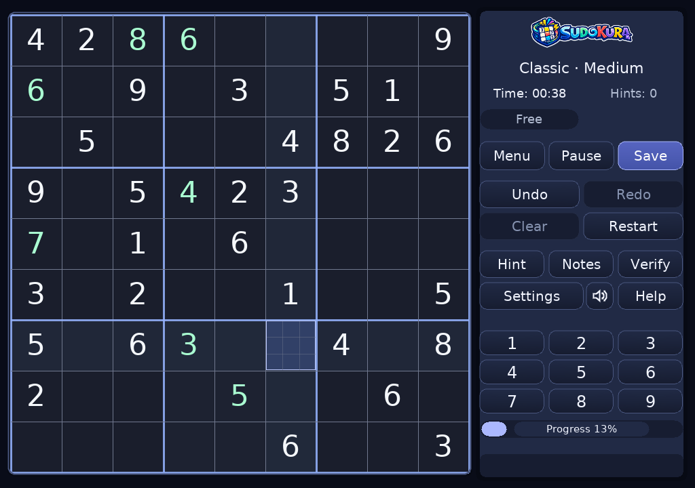
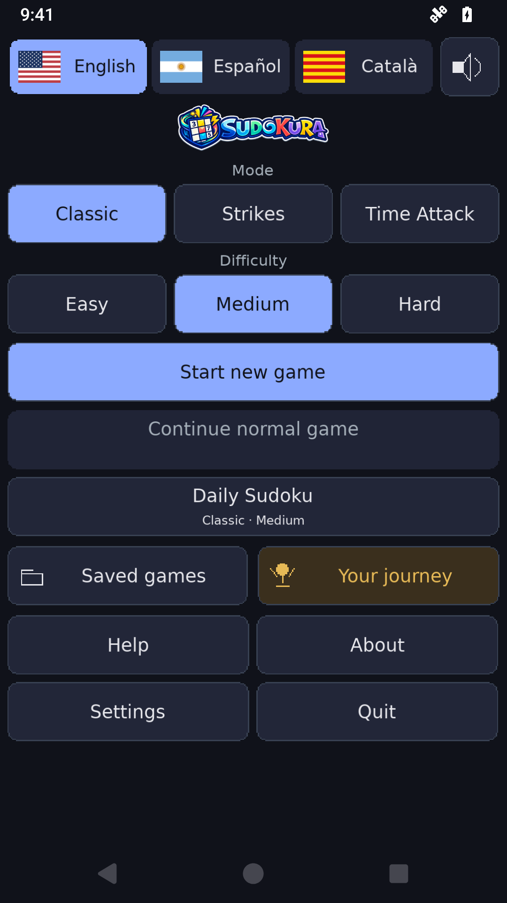
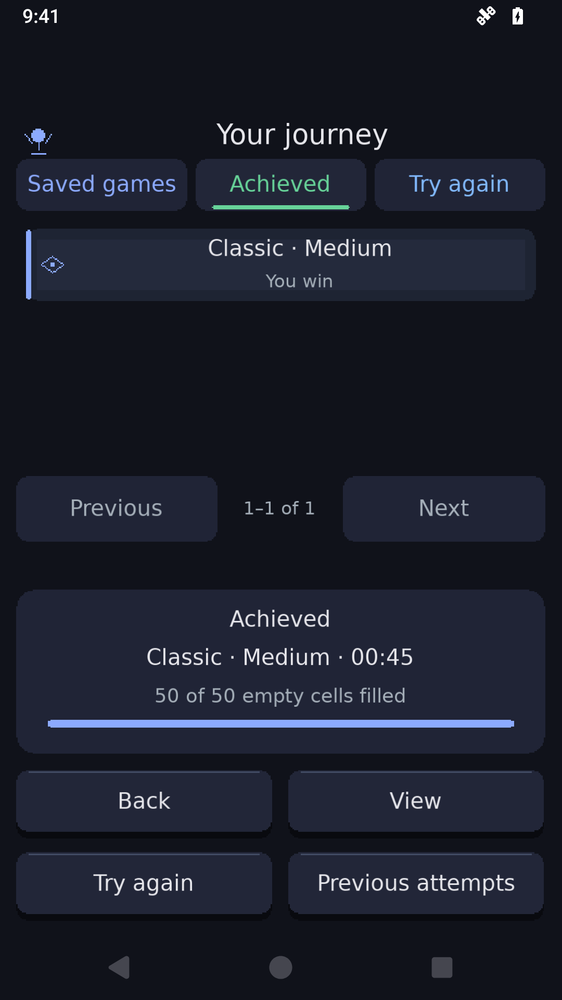
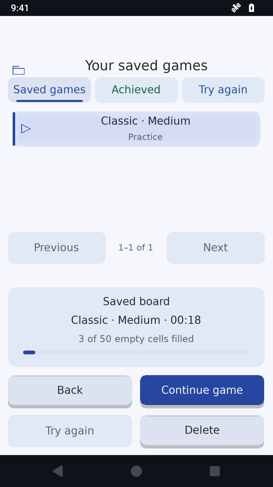
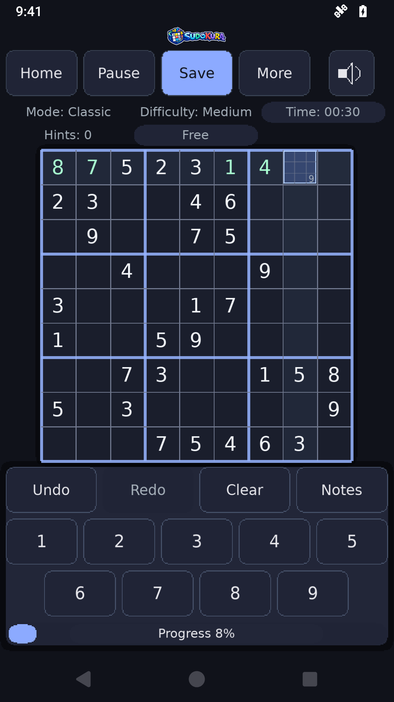
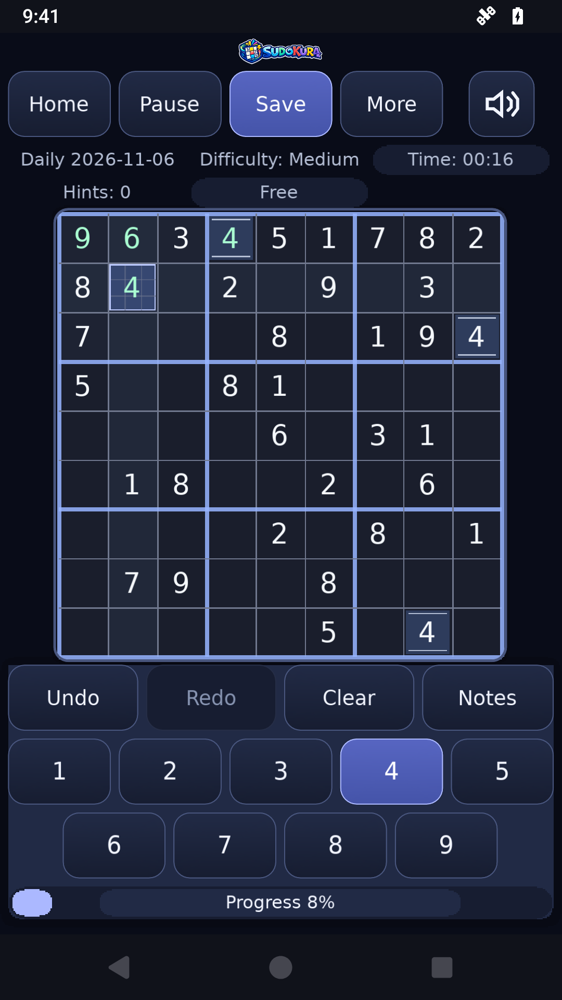
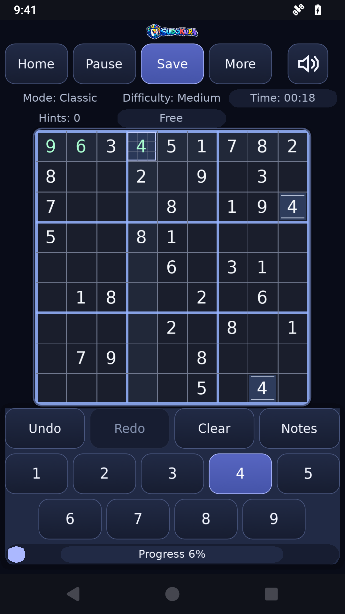
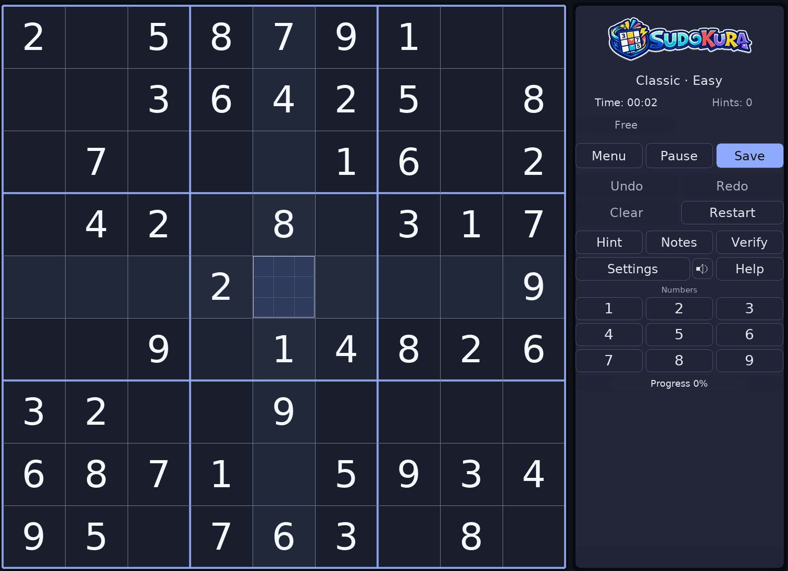
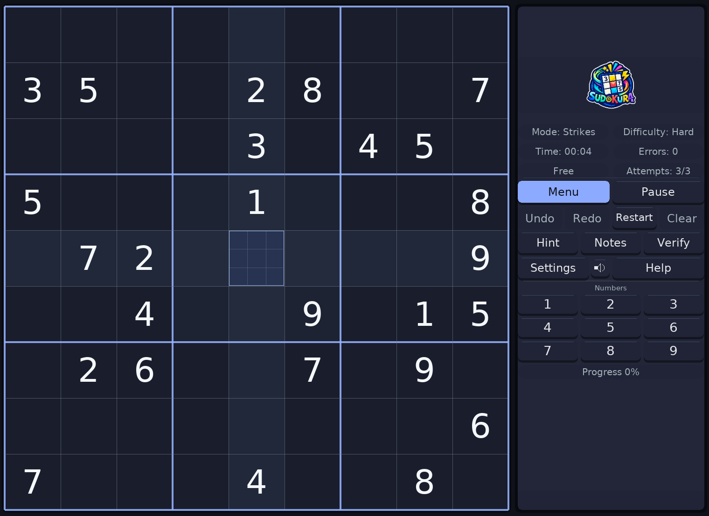

# The Sudokura gallery

A real Sudoku board is a better introduction than a wall of technical details. These genuine captures are kept with their release history so you know what you're looking at.

[Back to Sudokura](../../README.md) · [What's new in 1.4.0](../RELEASE_NOTES_1.4.0.md)

## Sudokura v1.4.0

### Desktop gameplay with the unified design

- **`sudokura-v1.4.0.png`:** a new native 1024 × 720 capture of real Classic gameplay from the 1.4.0 Linux AppImage with the unified interface, entered numbers, a pencil note, and the actual gameplay controls. This is not a generated mockup or an Android screen.
- Six matching **Android phone screenshots** in the canonical [Fastlane source](../../fastlane/metadata/android/en-US/images/phoneScreenshots/) were captured on a disposable x86_64 Android emulator from source-equivalent 1.4.0 UI, in English. The Android arm64 release-signing, device-runtime and store approval gates are independent. Spanish and Catalan phone captures have not been claimed.

### Android phone gallery

<table>
<tr>
<td align="center" valign="bottom"></td>
<td align="center" valign="bottom"></td>
<td align="center" valign="bottom"></td>
<td align="center" valign="bottom"></td>
<td align="center" valign="bottom"></td>
<td align="center" valign="bottom"></td>
</tr>
<tr>
<td align="center"><strong>Home</strong></td>
<td align="center"><strong>Achieved</strong></td>
<td align="center"><strong>Saved&nbsp;Games</strong></td>
<td align="center"><strong>Classic</strong></td>
<td align="center"><strong>Daily</strong></td>
<td align="center"><strong>Try&nbsp;again</strong></td>
</tr>
</table>

The six 1080 × 1920 PNGs are authentic Android emulator captures. The only conversion is lossless, pixel-equivalent RGB encoding from the native screenshots; no interface objects were painted, composited, resized or replaced. Five show the dark theme; Saved Games shows the light theme. These images are **not** evidence that Google Play or F-Droid has published a listing. The three real game-board views show Classic, the dated Daily and a genuine Try again replay.

## Sudokura v1.3.9 (historical)

### Main desktop gameplay image

- `sudokura-v1.3.9.png` — the maintainer-approved reuse of the unchanged regular desktop gameplay screenshot from v1.3.8, with identical image bytes. The established desktop board and main controls remain represented accurately; the image does not depict the new touch gestures, compact More panel, Saved Games scrolling or the experimental Android prototype.

## Sudokura v1.3.8 (historical)

### Main desktop gameplay image

- `sudokura-v1.3.8.png` — an exact copy of the maintainer-approved v1.3.7 gameplay screenshot, reused for the familiar regular desktop layout. The v1.3.8 compact More panel and Saved Games paging are not pictured.

## Sudokura v1.3.7 (historical)

### Original approved gameplay screenshot

- `sudokura-v1.3.7.png` — the original approved screenshot of the v1.3.7 desktop interface.

## Sudokura v1.3.0 (historical)

### Earlier canonical screenshot

- `sudokura-v1.3.0.png` — canonical v1.3.0 screenshot, supplied and approved by the user.

### Additional screenshots

- [Home / Continue](sudokura-v1.3.0-home.png)
- [Settings](sudokura-v1.3.0-settings.png)
- [Audio controls](sudokura-v1.3.0-audio-controls.png)
- [Notes — compact layout](sudokura-v1.3.0-notes-compact.png)
- [Help — compact layout](sudokura-v1.3.0-help-compact.png)

## Earlier releases

- `sudokura-v1.2.0.png` — canonical v1.2.0 screenshot.
- `sudokura-v1.1.0.png` — v1.1.0 interface.
- `sudokura-v1.png` — original v1 interface.

Canonical release screenshots use `sudokura-v<version>.png`; supplemental screenshots use descriptive suffixes.
