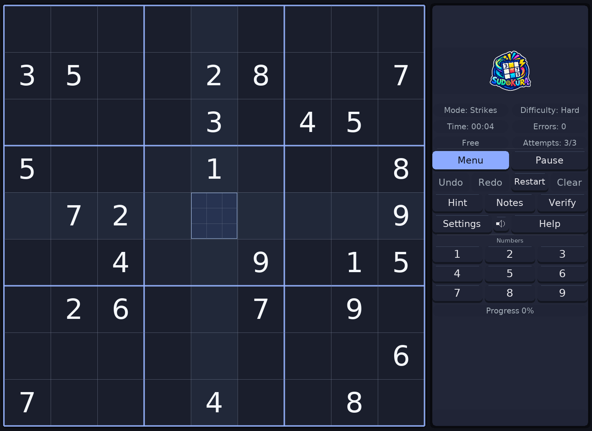

# Documentation images

## Sudokura v1.3.8

### Main desktop gameplay image

- `sudokura-v1.3.8.png` — an exact copy of the maintainer-approved v1.3.7 gameplay screenshot, reused for the familiar regular desktop layout. The v1.3.8 compact More panel and Saved Games paging are not pictured.

## Sudokura v1.3.7 (historical)

### Original approved gameplay screenshot

- `sudokura-v1.3.7.png` — the original approved screenshot of the v1.3.7 desktop interface.

## Sudokura v1.3.0 (historical)

### Earlier canonical screenshot

- `sudokura-v1.3.0.png` — canonical v1.3.0 screenshot, supplied and approved by the user.

### Additional screenshots

- [Home / Continue](sudokura-v1.3.0-home.png)
- [Settings](sudokura-v1.3.0-settings.png)
- [Audio controls](sudokura-v1.3.0-audio-controls.png)
- [Notes — compact layout](sudokura-v1.3.0-notes-compact.png)
- [Help — compact layout](sudokura-v1.3.0-help-compact.png)

## Earlier releases

- `sudokura-v1.2.0.png` — canonical v1.2.0 screenshot.
- `sudokura-v1.1.0.png` — v1.1.0 interface.
- `sudokura-v1.png` — original v1 interface.

Canonical release screenshots use `sudokura-v<version>.png`; supplemental screenshots use descriptive suffixes.
